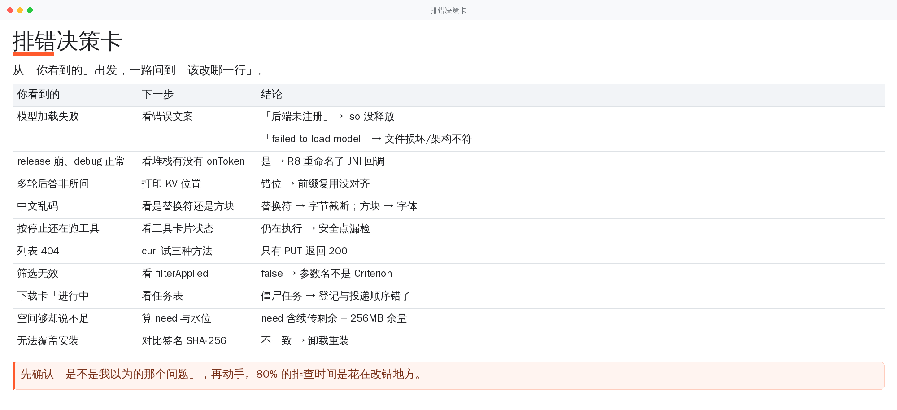

# 故障排查手册

> 🌐 语言 / Language: 中文 · [English](TROUBLESHOOTING.en.md)

按「你看到的症状」索引。每条都给出：怎么确认、为什么、怎么修。

> 分成两段：**站点侧**（Python / 静态产物 / PWA / 流水线）与**应用侧**（Android / llama.cpp）。
> 站点的问题在 CI 里有断言，但断言本身也会失效 —— 所以第一段里每条都写了
> 「怎么确认这条断言现在还在工作」。



> 想快速定位？先看这张卡，再往下翻细节。

## 站点侧

| 症状 | 大概率原因 | 跳转 |
|---|---|---|
| 页面能打开，但搜索框输入没反应 | 内联 JS 语法错误（整段脚本解析失败） | [S1](#s1-搜索框能打字但永远没有结果) |
| 表头点了没反应 | 页面脚本放进了 `<head>` | [S2](#s2-表头排序点不动) |
| 装了 PWA，之后再也看不到新版 | 缓存策略写成了缓存优先 | [S3](#s3-装成-app-之后再也看不到新版) |
| 某张页面在 390px 上要横向拖 | 表格 `layout:auto` 按内容分配宽度 | [S4](#s4-手机上传表横向溢出) |
| `check_site` 说 `content.json` 缺文件 | `content.json` 写早了 | [S5](#s5-contentjson-说产物里有未登记文件) |
| 两次构建产物不一致 | 有东西把「当前时间」写进了产物 | [S6](#s6-两次构建产物不一致) |
| 商店页版本是旧的 | 快照过期（`sync` 挂了） | [S7](#s7-商店页版本过期) |
| 站点绿着但线上是旧版 | 部署没触发 / 部署的不是这份 | [S8](#s8-ci-全绿但线上还是旧版) |
| 守卫全绿，但明明有缺陷 | 守卫是橡皮图章 | [S9](#s9-注入了缺陷自检还是全绿) |

### S1. 搜索框能打字，但永远没有结果

**怎么确认**：

```bash
python3 scripts/js_syntax.py        # 它会指出哪张页面的第几段 <script> 语法错
```

或者直接看浏览器控制台——`Uncaught SyntaxError`。

**为什么**：内联脚本里有语法错误时，**整段**都不执行。输入框仍然能获得焦点、
能打字（那是 HTML 的能力），只是没有监听器。页面外观、HTTP 状态码、构建结果全部正常。

本版真实发生过一次：`SEARCH_JS` 是普通三引号字符串，字符类正则
`/[.*+?^${}()|[\]\\]/g` 里的 `\\` 被 Python 折成 `\`，JS 收到
`/[.*+?^${}()|[\]\]/g`，字符类提前闭合。

**怎么修**：把那一段 JS 所在的字符串改成 raw（`r"""…"""`），或者把反斜杠写对。
改完跑 `js_syntax.py`。

**这条断言自己会不会哑**：`mutate_v2.py` 里有两条用例专门注入 JS 语法错误。
跑 `python3 scripts/mutate_v2.py`，如果「内联脚本出现语法错误」那条没过，说明守卫哑了。

### S2. 表头排序点不动

**怎么确认**：控制台里 `document.querySelectorAll('th.sortable').length` 是不是 0。
是 0 就说明脚本没跑。

**为什么**：页面专属脚本被渲染到 `<head>` 里，`querySelectorAll` 执行时 DOM 还没解析。

**怎么修**：`build_site.page()` 的 `extra_head` 参数其实渲染到 `</body>` 之前——
名字有误导，但行为是对的。检查调用方有没有绕过 `page()` 自己拼 `<script>`。

> 这一条静态检查抓不到（`data-sort` 属性在 HTML 里，检查会绿）。只能靠浏览器里点一下。

### S3. 装成 App 之后再也看不到新版

**怎么确认**：DevTools → Application → Cache Storage，看缓存名里那串哈希有没有变。

**为什么**：`sw.js` 的 fetch 策略写成了「缓存优先」。那样用户装完之后一直拿旧页面，
而且**无法自愈**——这比不能离线严重得多。

**怎么修**：保持 `try { await fetch(req) } catch { caches.match(req) }` 的顺序。
缓存名必须带构建指纹（`icesuite-<build.id 前 12 位>`），这样内容一变旧缓存就会被
`activate` 清掉。

### S4. 手机上传表横向溢出

**怎么确认**：390px 下 `document.documentElement.scrollWidth > window.innerWidth`。

**为什么**：`table-layout:auto` 按内容分配宽度，一列长日期就能把别的列挤出去。

**怎么修**：`table-layout:fixed` + 列宽算死；窄屏（≤640px）隐藏 ABI 与标签两列。
改完在 390 / 1024 / 1280 三个宽度下都量一遍 `table.scrollWidth` 对 `parent.clientWidth`。

### S5. `content.json` 说产物里有未登记文件

**怎么确认**：自检的最后几行会列出文件名。

**为什么**：`content.json` 生成得太早。它是产物索引，必须在**全部文件写完之后**才算。

**怎么修**：确认 `build_site.main()` 里 `_content_index()` 是最后一步。
CI 里还有一条更早的断言（`deploy.yml` 的 Assert output），它会列出缺哪个文件。

### S6. 两次构建产物不一致

**怎么确认**：

```bash
python3 scripts/check_site.py --reproducible
```

**为什么**：有东西把「当前时间」或随机数写进了产物。最常见的两处：
`generated_at` 用了 `iso_now()`，以及代码里用了 `datetime.now()`。

**怎么修**：`generated_at` 用 `util.source_stamp()`（快照时间）。
要算「距今多少天」用 `util.days_between()` 的序数日相减，不 import datetime。

### S7. 商店页版本过期

**怎么确认**：

```bash
GH_TOKEN=… python3 scripts/sync.py --check     # 快照 vs 线上
```

**为什么**：`sync.yml` 挂了，或者 `SYNC_PAT` 失效（默认 token 推的提交不触发 deploy，
兜底那一步也可能失败）。

**怎么修**：看 Actions → Sync registry 最近一次运行。连续失败超过一天，
`ci.yml` 的 `releases` job 会红。

### S8. CI 全绿但线上还是旧版

**怎么确认**：

```bash
python3 scripts/live_check.py --retries 8
```

它会比对产物指纹、`update.json`、并抽样下载 APK 实算 sha256。

**为什么**：本地检查抓不到这一类——它手里那份本来就是对的。这个仓库的两次事故
都是这个形状（店里 v2.6.0、线上已经 v2.7.1，而构建和自检都绿着）。

**怎么修**：先看 `deploy.yml` 最近一次运行有没有真的 deploy，再看 Pages 环境是部署了
哪个 commit。`live` job 每周会跑一次，出问题会红。

### S9. 注入了缺陷，自检还是全绿

**怎么确认**：

```bash
python3 scripts/mutate_v2.py       # 它自己会说哪条守卫是橡皮图章
```

**为什么**：断言太松。最常见的三种写法：

1. 只查「全站任意一处出现 X」——删掉 21 张页面里的 20 张照样绿
2. 只数总数——一个空、一个多，总数不变
3. 用全文搜索代替「在这一段里搜」——页脚里有一份同名链接就够了

**怎么修**：把断言收窄到具体容器（按 `<section>` 切段、按 `entrygrid` 截取），
然后**在变异测试里加一条同名用例**。

> 还有第四条，也是最隐蔽的：**变异测试自己变成橡皮图章**。
> 如果所有「改页面」的注入都被另一条断言先抓走，新守卫就从未被验过。
> `mutate_v2.py` 里的 `edit_page()` 会同步刷新 `content.json` 的哈希，就是为了这个。

## 快速分诊（应用侧）

| 症状 | 大概率原因 | 跳转 |
|---|---|---|
| 模型加载必然失败 | 多档后端 `.so` 没释放 | [1](#1-模型加载失败) |
| 加载失败但 `.so` 正常 | R8 把 JNI 回调方法名改了 | [2](#2-release-包加载就崩debug-正常) |
| 多轮之后答非所问 | KV 前缀复用位置错位 | [3](#3-多轮对话开始答非所问) |
| 中文变乱码 / 截断 | UTF-8 分片或转码 | [4](#4-中文输出乱码或被截断) |
| 按了停止工具还在跑 | 取消检查点不全 | [5](#5-按了停止工具还在执行) |
| 工具调用变成残缺文本 | `special=false` 丢了特殊 token | [6](#6-工具调用变成残缺文本) |
| 列表 404 | 接口必须用 PUT | [7](#7-模型列表-404) |
| 筛选不生效 | 参数名不是 `Criterion` | [8](#8-筛选条件被忽略) |
| 下载卡住不动 | 任务表登记顺序错了 | [9](#9-下载永远显示进行中) |
| 空间明明够却说不足 | 计入临时文件与余量 | [10](#10-空间明明够却说不足) |
| 预览页抓到本地文件 | `allowUniversalAccessFromFileURLs` | [11](#11-预览页能读到应用私有文件) |
| Release 包无法覆盖安装 | 签名不一致 | [12](#12-安装时无法覆盖) |

## 1. 模型加载失败

**先看界面给的错误**。`nativeLastError()` 会区分「后端未注册」和「模型文件问题」。

```bash
adb logcat -s LlamaBridge LlamaEngine
# 关键字：backendCount=0 / load model failed / unknown model architecture
```

**如果看到「后端注册数为 0」**：

```bash
# 确认 .so 是否真的落盘到了 nativeLibraryDir
adb shell ls -l /data/app/*/com.mscope.browser-*/lib/arm64/
```

看不到 `libggml-cpu-android_*.so` 就是这个问题。根因是 `useLegacyPackaging = false`
（等价 `extractNativeLibs=false`）：`.so` 只存在 APK 里，磁盘上没有，
而 `ggml_backend_load_all_from_path` 是按路径 dlopen 的。

修法：`app/build.gradle` 里 `packaging { jniLibs { useLegacyPackaging = true } }`，别动它。

## 2. release 包加载就崩，debug 正常

```text
java.lang.RuntimeException: no non-static method
  "com.mscope.browser.llama.LlamaBridge$TokenCallback.onToken(Ljava/lang/String;)V"
```

native 层用 `GetMethodID(cbClass, "onToken", "(Ljava/lang/String;)V")` 按**字符串**找方法，
R8 把 `onToken` 重命名了就找不到。这类问题编译期无法验证——`assembleRelease` 通过并不代表运行可用。

修法：`proguard-rules.pro` 保留 `TokenCallback` 及**所有实现类**的 `onToken`。
新增 JNI 回调时必须同步加 keep 规则，然后人工复核产物 dex：

```bash
unzip -o app-release.apk classes.dex -d /tmp/dex
# 用 dexdump / jadx 确认 onToken 符号仍在
```

## 3. 多轮对话开始答非所问

**现象**：前两轮正常，第三轮开始答非所问，偶发崩溃。

**原因**：上一轮生成结束后，KV 里还留着「上一轮输出」的 token，而记录里只有 prompt 部分。
直接在这段序列上做前缀匹配，命中位置整体错位，`llama_memory_seq_rm` 删掉了别的区间，
随后 decode 的位置与 KV 实际内容不一致。

**确认**：在多轮后打印 `llama_memory_seq_pos_max` 与预期位置对比。

**修法**：先用公共前缀重建一份「按位置对齐」的序列，再做带位置的删除。见 `llama_bridge.cpp`
中 KV 复用段落。

## 4. 中文输出乱码或被截断

两种不同的病：

| 现象 | 原因 | 处理 |
|---|---|---|
| 中文变成 `????` 或方块 | 用 `std::u16string(s.begin(), s.end())` 逐字节加宽 | 走完整 UTF-8 → UTF-16 转换 |
| 每段固定长度处断在半个字 | token 边界切在 UTF-8 多字节序列中间 | 按完整字符切分（`TextKit.endsWithCompleteChar` 同类逻辑） |
| emoji 直接丢失 | BMP 外字符走了 16 位路径 | 用 `codePointAt` 级别处理 |

单测里对「按任意字节位置截断都不出现替换符」有覆盖：`CoreKitTest.trimUtf8_neverCutsThroughChar`。

## 5. 按了停止，工具还在执行

**原因**：智能体循环只在「生成」阶段检查取消。生成被打断后，本轮已解析出的工具调用仍会执行——
包括真命令。

**修法**：每个安全点（解析后、确认前、执行前）都检查 `stoppedBy(gen)`；确认弹窗里按停止也让该工具不执行。

## 6. 工具调用变成残缺文本

**现象**：气泡里出现 `name="web_search">` 这种没有标签头的碎片，工具一次都没执行。

**原因**：`llama_token_to_piece` 传了 `special=false`。llama.cpp 对 `CONTROL` / `UNKNOWN` 属性的 token
直接返回空串，而 MiniCPM5 把 `<function>` / `<param>` 做成了特殊 token——标签头被静默丢弃。

**修法**：传 `special=true`（llama.cpp 自身 server / CLI 的默认行为）。

## 7. 模型列表 404

**确认**：

```bash
curl -i -X POST https://www.modelscope.cn/api/v1/dolphin/models -d '{"PageSize":1}'   # 404
curl -i -X GET  https://www.modelscope.cn/api/v1/dolphin/models                          # 404
curl -i -X PUT  https://www.modelscope.cn/api/v1/dolphin/models -d '{"PageSize":1}'   # 200
```

接口只认 `PUT`。部分企业网关会拦 PUT，此时应用会自动降级为首页聚合数据（`fallback` 标记为 true），
兜底还有「网页模式」。

## 8. 筛选条件被忽略

参数名是 **`Criterion`**（数组），不是 `SingleCriterion`——后者会被服务端静默忽略，返回全量。
筛选维度的取值来自响应里的 `Data.FiledAgg`，界面上出现的条件一定是服务端支持的。

## 9. 下载永远显示「进行中」

**原因**：`start()` 先投递任务、后登记任务表。单线程池可能在上半段代码执行前就跑完 `run()`
并把任务从表里摘掉，随后任务又被塞回去，留下一个「永远显示下载中、实际什么都没发」的僵尸任务。
另一种是取消走了提前返回分支，绕过 `tasks.remove()`，任务卡在表里，同一个文件再也点不动。

**修法**：先 `putIfAbsent` 登记再投递；取消统一走主流程（发请求前先判一次），保证一定 `finish()`。

## 10. 空间明明够却说不足

`StorageGuard` 的判据不是「剩余 > 文件大小」：

```text
need = 文件总长 - 已下载部分        (续传时只算剩余)
可用 - need ≥ 256 MB               (安全水位)
可用 ≥ 128 MB                      (硬下限)
```

留余量是必要的：下载完还要原子改名、写索引，系统也需要空间做页缓存。

## 11. 预览页能读到应用私有文件

**原因**：`allowUniversalAccessFromFileURLs = true`，而预览页渲染的正是模型生成的 HTML。
一段 `fetch('file:///data/data/com.mscope.browser/files/chats.json')` 就能把对话历史读出来发走。

**修法**：关掉它。关掉后相对资源的 `` / `<script>` / `<link>` 仍正常，核心预览需求不受影响。

## 12. 安装时「无法覆盖」

签名不一致。检查：

```bash
apksigner verify --print-certs 已装的.apk | grep SHA-256
apksigner verify --print-certs 新下载的.apk | grep SHA-256
```

v1.2 的 Release 包是 debug 签名（CI 未配 Secrets 时的静默回退），必须卸载才能装新的。
现在 tag 构建缺 Secrets 会直接失败，不会再产出这种包。

## 13. 生成速度突然变慢

先看状态条：v2.5.0 起会显示本次 / 均值 / P90。明显低于本次会话均值时会给出提示。

| 原因 | 表现 | 处理 |
|---|---|---|
| 线程数超过可用核数 | 单次 decode 从 28ms 恶化到 3952ms（线程屏障自旋） | 按 `Cpus_allowed_list` 取真实可用核数 |
| 物理批太大 | 计算缓冲区 ~311MB，GC 压力大 | `n_ubatch` 512 → 128，缓冲 ~78MB |
| 后台任务 / 散热 | 整体 tok/s 下降 | 关后台、降一档上下文 |
| 上下文过大 | 预填充变慢，内存吃紧 | 按建议值下调 |

## 14. 收集诊断信息

提 Issue 时请附上：

```bash
adb shell getprop ro.product.model
adb shell getprop ro.build.version.release
adb shell cat /proc/meminfo | head -3
adb shell cat /proc/cpuinfo | grep -m1 "Hardware\|model name"
adb logcat -d -s LlamaEngine LlamaBridge DownloadCenter AgentTools ToolCall > log.txt
```

另外：模型文件名（含量化类型）、上下文设置、是否开了智能体。
